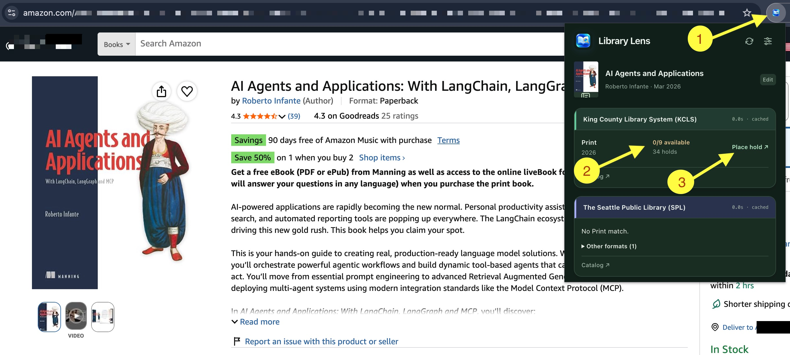

# Library Lens

**License:** [PolyForm Strict 1.0.0](LICENSE.md). You can read and use Library Lens for noncommercial purposes. You cannot redistribute it, modify it, or use it commercially. Copyright © 2026 Abhijit Gore.

Check a book at your libraries from its Amazon, Barnes & Noble, or Goodreads page. Open the library website to place a hold or request a purchase.



1. Open Library Lens on a book page.
2. Check availability at your selected libraries.
3. Select **Place hold** to continue on the library website.

## Support

Library Lens supports selected libraries in the **Seattle area and San Francisco Bay Area**. It does not support libraries across the whole US.

Library Lens is an independent project. It is not affiliated with, endorsed by, or sponsored by any library, Amazon, Barnes & Noble, or Goodreads.

| Area | Supported library catalogs |
| --- | --- |
| Seattle area | King County Library System (KCLS), The Seattle Public Library (SPL), University of Washington Libraries (UW) |
| Bay Area | San Francisco Public Library (SFPL), San José Public Library (SJPL), Oakland Public Library (OPL), MARINet, San Mateo County Libraries (SMCL) |

Use a single book page on **amazon.com**, **bn.com** (Barnes & Noble, which opens barnesandnoble.com), or **goodreads.com**. Search results, book lists, and other websites are not supported.

For the supported workflow, **sign in to the source website and your selected library websites before use**. Keep those sessions active. The extension uses the page you open. It does not sign in for you or check your account details. A library can ask you to sign in again before a hold or purchase request.

Library Lens does not collect or store library usernames, card numbers, or passwords. You complete account actions on the official library website. This extra sign-in step is a deliberate choice to protect security and privacy.

## Install or update

1. Open `chrome://extensions` in Chrome.
2. Turn on **Developer mode**.
3. Select **Load unpacked**. Choose this project's `extension` folder.
4. To update an existing installation, select **Reload** on its extension card.
5. Confirm version **0.11.24**. Pin Library Lens from Chrome's Extensions menu.

An extension reload clears its temporary book data. Prepare a purchase request again after an update. To remove the extension, use Chrome's extension manager.

## Set your libraries

Open **Settings** from the popup's sliders button or Chrome's **Extension options** link.

1. Enter a five-digit ZIP code. Select **Find libraries**.
2. Choose up to three supported libraries. Select **Save selection**.
3. Choose **Print**, **eBook**, or **Audiobook** as your preferred format.

ZIP search runs on your device. It lists supported systems with a branch within 75 miles. The distance is approximate. It does not confirm your right to a library card. The extension does not send or save your ZIP code.

## Check a book

1. Sign in to Amazon, Barnes & Noble, or Goodreads.
2. Open the book's own page. Then select Library Lens.
3. Read the results for your selected libraries. Your preferred format appears first. Expand **Other formats** for more choices.
4. Select **Place hold** to open the matching library record. Sign in to that library if asked. Complete the hold there.

Any supported book edition, including an Amazon audiobook, can supply the title and author. If it has no ISBN, the extension searches by title and author. Your preferred reading format still controls which library results appear first.

The book header shows the title, author, publication date, and edition when known. Select **Edit** to correct the details. Changes start a new search after a short pause. Press Enter to search at once.

Select **Refresh** to clear the temporary search and verification caches, read the current page again, and check the catalogs again. A prepared purchase request stays in memory.

Results are reused for ten minutes. A catalog error does not mean the library has no copy. An **On order** result means the catalog reports incoming copies. Availability can change after a search.

Amazon and Barnes & Noble supply book details directly. Goodreads details require an independent title-and-author match from a selected library catalog or the Library of Congress. If a catalog confirms a different edition, its edition details replace the unverified details. If no source confirms the book, open it on Amazon or Barnes & Noble and try again.

A Goodreads rating appears only when the open Goodreads page supplies it. No Goodreads API is used.

## Request a purchase

A purchase action appears only when the catalog returns no results. Existing copies, including copies in use, lead to a hold instead.

- **KCLS and SPL:** Select **Request purchase**. The official form opens. Sign in and choose a format if asked. Select the floating **Fill details** control beside the form. Review the fields and submit the request yourself.
- **SJPL and UW:** Open the official purchase-suggestion page from the result. Complete the form yourself.
- Other supported libraries provide catalog and hold links only.

The KCLS/SPL helper fills book fields only. It leaves account, contact, pickup, fee, and loan choices to you. Adults is the default audience unless the page identifies another audience. Existing choices and conflicting text are kept.

The extension remembers one prepared book. Preparing another book replaces it. A complete fill clears the prepared book and search cache. An incomplete fill keeps the book for retry. Use **Copy book details** or **Forget book** in the popup when needed.

The prepared book becomes invalid after one hour and is removed when next accessed. An extension reload or browser restart also clears session data. Text already copied or filled into a library form remains there independently.

In Settings, select your libraries and use the sign-in links to open their official account pages. These links remain available when you return to Settings. Library sessions can expire; Library Lens does not check login status.

## Privacy

The full privacy policy is in [PRIVACY.md](PRIVACY.md). In short:

- A source page is read only when you open Library Lens on a supported book page. It does not read your browsing history or inspect other websites.
- Only your selected library IDs and preferred format are saved in local settings. Your ZIP is used for local ranking and is not saved or sent.
- Book details, catalog results, and one prepared purchase request use temporary browser-session storage. They are not written to persistent extension storage.
- Your selected catalogs receive the book title, author, and ISBN. Goodreads verification can also send the ISBN to `lx2.loc.gov`. These search requests omit cookies and the source-page URL. Book searches can reveal reading interests to these services.
- Cover images load only from the Amazon and Barnes & Noble image servers, without a referrer and without cookies. That image server still receives the request and your network address.
- Library Lens does not collect names, contact details, library credentials, or passwords. It has no analytics or remote AI service. It does not submit holds or purchase requests.

The extension uses `activeTab`, `scripting`, and `storage` permissions. Network access is limited to the supported catalog, verification, and request hosts. The KCLS/SPL helper appears only in the request tab opened for the prepared book. It and the popup's Paste action write only to the official KCLS or SPL request form, and only when you choose them. Neither reads or fills login fields.

Ten minutes is the cache's reuse limit, not a deletion deadline. Cached data can remain in session storage until replaced, refreshed, cleared after a complete fill, or the browser session ends.

## Development

Runtime code uses native JavaScript modules. No runtime package dependency or build step is required. Development uses Node.js 22 or later, Python 3, and Playwright with Chromium. No library account or API key is needed for tests.

```sh
npm ci
npx playwright install chromium
npm test
npm run test:retailers
npm run test:browser
npm run test:security
npm run check:public
npm run package
```

The retailer checks use small public page fixtures for Amazon, B&N, and Goodreads. Browser checks use catalog and form fixtures. They do not use real accounts or submit requests. Live websites can change; passing fixture tests does not guarantee every future page layout will work.

The ZIP in `dist` contains runtime files only. Extract it before using **Load unpacked**.

| File | Purpose |
| --- | --- |
| `extension/popup.js` | Read the clicked page and show library results |
| `extension/lib/extract.js` | Extract bounded book fields without running page scripts |
| `extension/lib/read-page.js` | Retry briefly while book details load |
| `extension/lib/verification.js` | Check Goodreads identity against independent records |
| `extension/lib/catalog.js` | Build fixed-host requests and parse bounded responses |
| `extension/background.js` | Coordinate requests, caches, and purchase tabs |
| `extension/lib/preferences.js` | Save only library IDs and preferred format |
| `extension/settings.js` | Rank nearby supported libraries on the device |

The ZIP directory uses bundled Census ZIP-area and IMLS public-library outlet data, plus a UW location. See [the data-source notes](data/README.md) to get the source archives and rebuild it. Raw archives are not part of the public repository.

The logo master is `assets/library-lens-master.png`. Run `node scripts/render-icons.mjs` on macOS to render the four Chrome icon sizes.

## Before a public commit or push

Run the tests above. Run `npm run check:public` after staging your public changes. It checks the exact Git index and rejects private folders, generated archives, personal email addresses, private file paths, and common secret formats. It does not replace a full secret scan or manual review.

If Gitleaks is installed, run `gitleaks git --redact` before a push. Review permissions, page-derived input, message senders, storage, network requests, and dependencies. Do not use passing functional tests as proof of security.

The browser security check tests literal-text handling, private-address cover rejection, response-size limits, and form boundaries. It also records the documented cover-image requests and session-data retention. It is not a full penetration test.

Local notes, historical proposals, Chrome Web Store submission materials, downloaded datasets, release backups, generated packages, browser profiles, and screenshots are excluded from Git. CI runs the public-file check, dependency audit, tests, and package validation. It does not publish the extension.

## Contributors

- Abhijit Gore — project creator and maintainer.
- OpenAI Codex — AI assistance with development and documentation.

Library Lens is licensed under the [PolyForm Strict License 1.0.0](LICENSE.md). See the notice at the top of this README.

Version 0.11.24 is a local trial. It is not a Chrome Web Store release.
